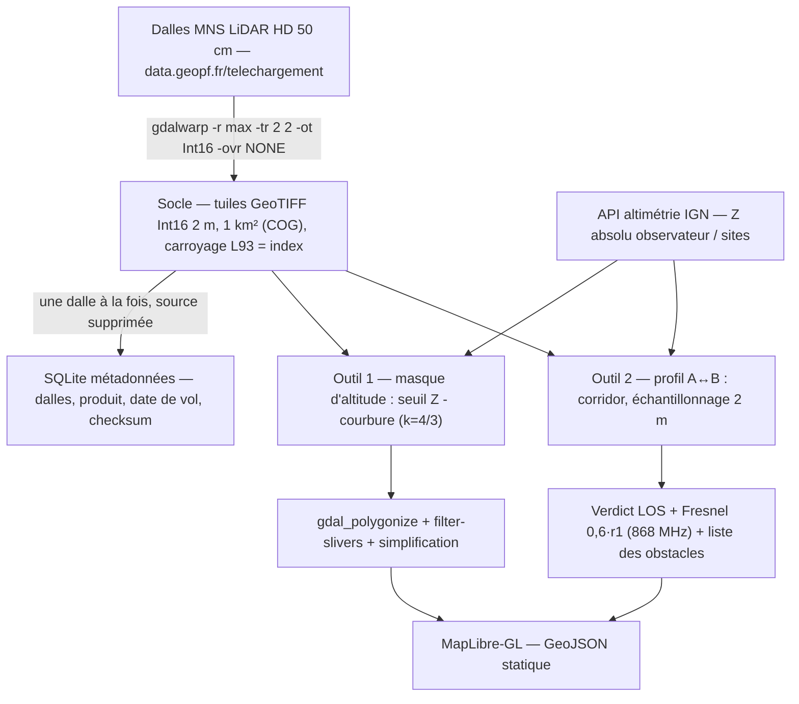

# Masque d'altitude & profils A↔B — socle terrain pour répéteurs MeshCore

## Besoin

Redéfini le 18/10/2026 (supplante le besoin « viewshed » du rapport R3) :

1. **Masque d'altitude** — un polygone avec trous représentant les cellules plus hautes que l'observateur (relief, bâti, forêt), sur un rayon allant jusqu'à 50 km, pour repérer les masses d'obstacles et les points hauts candidats à un répéteur.
2. **Profil A↔B** — valider le lien radio entre deux sites (terrain, courbure, Fresnel).

Aucune visibilité depuis l'observateur n'est calculée : R3 et `gdal_viewshed` sont abandonnés. Les décisions antérieures restent valables : pas fixe 2 m, rééchantillonnage **max** des dalles MNS 50 cm (`gdalwarp -r max -ovr NONE`), Int16, rayon max 50 km, altitude de l'observateur via l'API altimétrie IGN.

## Le socle de données — remplacement des « cellules SQLite »

### Comparatif des structures

| Option | Lecture fenêtre (masque 50 km : 1,96 Md cellules) | Lecture ponctuelle (profil A↔B) | Volume disque 50 km / France | Verdict |
|---|---|---|---|---|
| SQLite, 1 ligne par cellule | Mauvaise — scan ligne à ligne, minutes | Bonne si indexée | 29–49 Go / 2,1–3,4 To | **Écarté** : 8–10× le volume du raster, et le « scan des rows » réinvente un scan raster |
| GPKG raster (tuiles BLOB, PNG 16 bits) | Bonne — lecture par tuiles | Bonne — index de tuiles | ~ raster (≈ 4 Go / 275 Go) | Valable — un seul fichier, affinité SQLite conservée |
| **Répertoire de tuiles GeoTIFF 1 km² (une par dalle IGN, Int16, COG)** | Excellente — lecture séquentielle par blocs | Excellente — fichier trouvé par arithmétique | 3,9 Go / ~275 Go | **Recommandé** |

### Structure recommandée : le carroyage de dalles EST l'index

- **Une tuile = une dalle IGN = 1 km² en Lambert-93**, fichier GeoTIFF Int16 (2 m), idéalement écrit au format COG (overviews intégrées) : le carroyage national de l'IGN étant régulier, passer de (x, y) au fichier est une division entière par 1000 — **aucun index spatial à maintenir**, aucune base requise pour localiser une cellule.
- Le masque 50 km = lecture séquentielle de ≤ 7 854 fichiers (4 Go) ; un profil = lecture de la dizaine de tuiles traversées par la ligne.
- Le **VRT** (`gdalbuildvrt`) assemble une emprise à la demande sans dupliquer d'octets.
- **SQLite garde son vrai rôle : les métadonnées** — table (dalle, produit MNT/MNS, date de vol, date d'ingestion, source, checksum). C'est ce qu'il fait bien : petit volume, requêtes, intégrité.
- Un répertoire de petits fichiers est rustique et se synchronise/sauvegarde avec les outils habituels (rclone), là où un GPKG géant d'une seule pièce est fragile.

### De la dalle IGN à votre tuile

Les tuiles 2 m sont des **produits dérivés** ; les MNS/MNT 50 cm sont leurs **sources** :

1. téléchargement d'une dalle IGN (GeoTIFF 1 km², ~24 Mo, 2 000×2 000 px) ;
2. transformation `gdalwarp -r max -tr 2 2 -ot Int16 -ovr NONE` → tuile dérivée 500×500 px, 0,5 Mo, même emprise ;
3. suppression de la source 50 cm ;
4. la tuile garde le nom et l'emprise de la dalle IGN — le carroyage national devient l'index.

MNS et MNT sont ingérés de la même façon dans des sous-répertoires (`mns/`, `mnt/`) sur le même carroyage ; le MNH n'est jamais stocké : il se calcule à la demande par différence (MNS − MNT).

### Métadonnées embarquées dans chaque tuile

Chaque tuile est auto-porteuse : les items `-mo KEY=VALUE` de `gdalwarp` (ou `gdal_edit -mo` a posteriori) écrivent des balises GeoTIFF dans le fichier — GDAL y consigne déjà de lui-même le logiciel et sa version. Convention retenue :

| Balise | Contenu | Exemple |
|---|---|---|
| `SOURCE_PRODUIT` | produit IGN d'origine | `MNS_LIDAR_HD` |
| `SOURCE_DALLE` | identifiant de la dalle IGN | `MNS_5-0__0676_6560__L93-2153_D037_2023-02` |
| `SOURCE_CAMPAGNE` | mission/vol, des métadonnées IGN | `22LHDHH` |
| `INGEST_DATE` | date de la transformation | `2026-10-19` |
| `INGEST_OUTIL` | outil, version et paramètres | `gdalwarp 3.10 / r=max, tr=2m, Int16` |

Répartition des rôles : la tuile embarque les **faits de traçabilité** (d'où vient la donnée, comment elle a été produite) ; la table SQLite reste l'**index de recherche** (quelles dalles ingérées, quelle couverture, quelles dates de vol) — la base est entièrement reconstructible depuis les balises, jamais l'inverse.

### Volumétrie (rappel)

| Rayon | Cellules | Tuiles 1 km² | Int16 |
|---|---|---|---|
| 5 km | 20 M | 79 | 39 Mo |
| 20 km | 314 M | 1 257 | 628 Mo |
| 50 km | 1,96 Md | 7 854 | ~3,9 Go |

France entière : ~275 Go. Absorption des sources 50 cm : flux « une dalle à la fois » (télécharger → `gdalwarp -r max` → supprimer), pic disque ~25 Mo.

## Sources de données nécessaires

| Source | Rôle | Accès | Volumétrie |
|---|---|---|---|
| **MNS LiDAR HD (50 cm)** — surface : bâti + végétation | **Source principale du socle** : masque d'altitude, obstacles des profils | À la carte `cartes.gouv.fr/telechargement/IGNF_MNS-LIDAR-HD` ou API Atom `https://data.geopf.fr/telechargement` (10 req/s) | Dalles 1 km², ~24 Mo ; 126–190 Go pour un disque de 50 km |
| **MNT LiDAR HD (50 cm)** — sol nu | Altitude du sol aux sites A/B (base du mât), séparation relief/sursol | Même canal (`IGNF_MNT-LIDAR-HD`) | ~24 Mo/dalle 50 cm (version 5 m : ~0,5 Mo) |
| **MNH LiDAR HD (50 cm)** — hauteur (MNS−MNT) | Hauteur hors-sol des obstacles : toits installables vs canopée | Même canal (`IGNF_MNH-LIDAR-HD`) ; ou recalcul MNS−MNT | ~24 Mo/dalle |
| **BD TOPO (thème bâti)** — vecteur | Qualifier les points hauts : bâtiment (candidat installable) ou relief/végétation | WFS `https://data.geopf.fr/wfs/ows` — requêtes ciblées, pas de stockage massif | Négligeable (emprises ponctuelles) |
| **API altimétrie IGN (REST)** | Altitude absolue de l'observateur et des sites (ressources `ign_lidar_hd_*`) | `https://data.geopf.fr/altimetrie/1.0/calcul/alti/rest/elevation.json` | 5 000 pts/requête |

Licence unique : ouverte Etalab 2.0 (réutilisation libre, attribution). À noter : le MNS 50 cm seul suffit au démarrage ; le MNT complète pour le calcul d'altitude aux sites et le MNH peut être recalculé (MNS−MNT) si les deux rasters sont ingérés.

**Couverture** : le programme LiDAR HD doit couvrir toute la France métropolitaine et les DROM (hors Guyane) d'ici fin 2026 — avant d'industrialiser une zone, vérifier l'avancement sur la carte de suivi de l'IGN. Tours est couvert (vol 02/2023).

**Repli en zone non couverte** : nuages de points classés (COPC, 11 classes dont bâtiment et végétation, ~200 Mo/km² — génération de MNS/MNT maison, lourd) ; ou Copernicus DEM GLO-30 (30 m, mondial) pour du pré-dimensionnement grossier seulement.

## Outil 1 : masque d'altitude

Pipeline :

1. **Emprise** : rayon jusqu'à 50 km autour de l'observateur ; tuiles requises = arithmétique sur le carroyage.
2. **Altitude observateur** : API altimétrie IGN (Z absolu précis), jamais depuis la cellule max-poolée.
3. **Seuil avec courbure** : cellule = obstacle si `Z_cellule − Δh(d) > Z_observateur`, où `Δh = d² / (2·R_eff)` et `R_eff = k·R` avec **k = 4/3** (réfraction atmosphérique standard en radio ; R_eff ≈ 8 495 km). La distance horizontale d vient de la position grille de chaque cellule — quelques multiplications par cellule, aucun mystère.
4. **Vectorisation** : `gdal_polygonize` → MultiPolygon avec trous ; puis suppression des micro-trous (`mapshaper filter-slivers` ou filtre d'aire minimale) et simplification (tolérance ~5–10 m à 50 km).
5. **Sortie** : GeoJSON statique → couche `fill` MapLibre.

Sélection des points hauts (candidats répétiteurs) :

- **Maxima locaux** : filtre maximum glissant (ex. fenêtre 100–200 m) — chaque cellule égale au maximum de son voisinage est un sommet local ; WhiteboxTools fournit ce filtre en CLI.
- **Proéminence** : ne garder que les sommets dépassant leur environnement d'un seuil (ex. > 15–30 m au-dessus du rayon 500 m) — élimine les bosses mineures sur une crête continue.
- **Installabilité** : distinguer bâti (toit = candidat installable) de forêt (canopée = non installable) — le MNH (hauteur) ou l'outil « MapOffTerrainObjects » de WhiteboxTools séparent objets hors-sol et terrain.

## Outil 2 : profil A↔B

Pipeline :

1. **Entrées** : A et B (x, y, altitude) — altitudes via API altimétrie IGN ou depuis les dalles 50 cm d'origine ; hauteur d'antenne à chaque extrémité.
2. **Corridor** : la ligne A→B traverse n tuiles (10 pour 50 km à vol d'oiseau) ; échantillonnage tous les 2 m (~25 000 points pour 50 km) — lecture triviale.
3. **Gabarit de dégagement** : pour chaque point à la distance cumulée s, la ligne de visée directe est corrigée de la courbure (`Δh = d²/(2·R_eff)`, k = 4/3) ; le dégagement requis vaut **0,6 × r1** (critère usuel du premier ellipsoïde de Fresnel), avec `r1 = 17,32 × √(d1·d2 / (f·D))` mètres (d1, d2, D en km, f en GHz).
4. **Verdict** : lien dégagé si `Z_terrain + Δh_courbure < ligne_de_visée − 0,6·r1` partout ; sinon, liste des obstacles traversants (localisation, dépassement en mètres) — directement affichables sur la carte.

Ordres de grandeur à 868 MHz (mi-parcours) : r1 ≈ 29 m pour 10 km, 42 m pour 20 km, 66 m pour 50 km ; dégagement requis (0,6·r1) : ~18 / 25 / 39 m.

Références d'outils : `r.profile` (GRASS) échantillonne un profil de raster le long d'une ligne — le cœur de l'étape 2 ; Rodosto/UpToWhere (comparés précédemment) font la même chose mais sur données 30 m mondiales : votre avantage reste le LiDAR HD.

## Architecture d'ensemble

## Notes sur les sources

| Source | Fiabilité | Dernière mise à jour |
|---|---|---|
| [gdalwarp — méthode de rééchantillonnage max](https://gdal.org/en/stable/programs/gdalwarp.html) | 5/5 | - |
| [gdal_polygonize — documentation GDAL](https://gdal.org/en/stable/programs/gdal_polygonize.html) | 5/5 | - |
| [GPKG — driver raster GDAL (tuiles PNG 16 bits)](https://gdal.org/en/stable/drivers/raster/gpkg.html) | 5/5 | - |
| [COG — driver GDAL](https://gdal.org/en/stable/drivers/raster/cog.html) | 5/5 | - |
| [OGC — standard Cloud Optimized GeoTIFF](https://docs.ogc.org/is/21-026/21-026.html) | 5/5 | - |
| [r.profile — manuel GRASS](https://grass.osgeo.org/grass-stable/manuals/r.profile.html) | 5/5 | - |
| [WhiteboxTools — index des outils (filtre maximum, MapOffTerrainObjects)](https://jblindsay.github.io/wbt_book/tool_index.html) | 4/5 | - |
| [Holleman 2013 — Effective Earth's Radius Model (k = 4/3), Radio Science](https://agupubs.onlinelibrary.wiley.com/doi/full/10.1002/rds.20030) | 4/5 | 2013 |
| [SATEL USA — radio horizon et rayon effectif 4/3](https://www.satelusa.com/article-line-of-sight-radio-range-antenna-heights/) | 3/5 | - |
| [Calcul altimétrique — aide cartes.gouv.fr](https://cartes.gouv.fr/aide/fr/guides-utilisateur/utiliser-les-services-de-la-geoplateforme/calcul-altimetrique/) | 5/5 | - |
| [API de téléchargement — aide cartes.gouv.fr](https://cartes.gouv.fr/aide/fr/guides-utilisateur/utiliser-les-services-de-la-geoplateforme/telechargement/) | 5/5 | - |
| [MNS LiDAR HD — data.gouv.fr](https://www.data.gouv.fr/datasets/mns-lidar-hd) | 5/5 | - |
| [MNT LiDAR HD — data.gouv.fr](https://www.data.gouv.fr/datasets/mnt-lidar-hd) | 5/5 | - |
| [MNT LiDAR HD — aide cartes.gouv.fr](https://cartes.gouv.fr/aide/fr/partenaires/ign/observations-regulieres-territoire/relief/mnt-lidar-hd/) | 5/5 | - |
| [Programme LiDAR HD — IGN (couverture fin 2026)](https://www.ign.fr/institut/programme-lidar-hd-vers-une-nouvelle-cartographie-3d-du-territoire) | 5/5 | - |
| [Suivi du programme LiDAR HD — carte IGN](https://macarte.ign.fr/carte-narrative/voir/00de334e133511feb97a1d4f6065e438/Suivi_Programme_LIDAR) | 4/5 | - |
| [BD TOPO — data.gouv.fr](https://www.data.gouv.fr/datasets/bd-topo-r) | 5/5 | - |
| [Ressources WFS topographie — géoplateforme](https://data.geopf.fr/annexes/ressources/wfs/topographie.xml) | 5/5 | - |

Réserves : la taille « 1 km² / carroyage Lambert-93 régulier » des dalles IGN est attestée par les tutoriels communautaires et le flux de téléchargement (dalles 1 km²), non re-mesurée ; le critère 0,6·r1 et k = 4/3 sont des conventions de planification radio, pas des garanties météo (ducting, inversions) ; le volume SQLite ligne-par-cellule est une estimation d'ordre de grandeur (overhead 15–25 o/ligne), non mesurée.

## Questions ouvertes

- **MNS ou MNT pour la forêt à 868 MHz** : la canopée du MNS bloque « par principe » alors que la forêt est semi-transparente mais fortement atténuante — trancher à la mesure sur un lien réel en zone boisée.
- **Seuil de proéminence** pour les candidats répétiteurs (15 m ? 30 m ?) — arbitrage entre nombre de candidats et bruit.
- **k variable** : garder k = 4/3 ou prévoir un réglage (conditions météo standard vs ducting) ?
- **Fréquence paramétrable** : 868 MHz aujourd'hui (MeshCore SRD) — prévoir le paramètre si d'autres bandes arrivent (2,4 GHz : Fresnel deux fois plus petit).

## Recommandations

1. **Construire le socle d'abord** : ingestion d'une poignée de dalles de Tours, vérification de la géométrie (carroyage, Int16, max-pooling) sur le secteur déjà étudié (av. de l'Europe, 141,5 m NGF).
2. **Outil 2 avant l'outil 1** : le profil A↔B est le plus petit à bâtir (corridor + formules) et c'est lui qui valide les décisions radio ; le masque n'est qu'une aide au repérage.
3. **COG + VRT + SQLite métadonnées** : ni base de cellules, ni monofichier géant ; le carroyage IGN fait l'index.
4. **Geler les conventions radio par écrit** : k = 4/3, dégagement 0,6·r1, 868 MHz — un tableur de contrôle croisé avec un profil Rodosto sur les mêmes points (données 30 m) validera l'ordre de grandeur avant d'industrialiser.